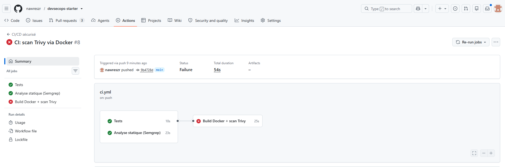
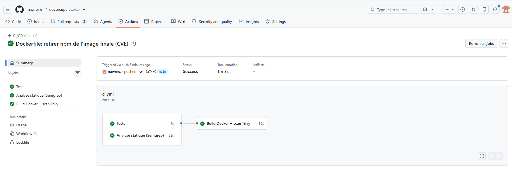

# devsecops-starter

Petite API Node.js **conteneurisée** avec un **pipeline CI/CD sécurisé** (tests, analyse statique, scan de vulnérabilités). Ce dépôt est le kit de démonstration de mon offre freelance : *conteneurisation Docker et pipeline GitHub Actions sécurisé pour applications web*.

## Problème
Beaucoup de petites applications sont déployées à la main, avec des images Docker lourdes, exécutées en root, sans test ni scan de sécurité automatique.

## Solution
- Dockerfile **multi-stage** (Node 22 Alpine) : dépendances de production seulement, exécution avec l'utilisateur non-root `node`, `HEALTHCHECK` intégré.
- `docker-compose.yml` durci : système de fichiers en lecture seule, toutes les capabilities retirées, `no-new-privileges`.
- Pipeline **GitHub Actions** : tests → analyse statique **Semgrep** → build Docker → scan **Trivy** (le pipeline échoue sur une CVE HIGH/CRITICAL corrigeable) → test de santé du conteneur.
- **Dependabot** : mises à jour hebdomadaires (npm, Docker, Actions).
- API avec en-têtes de sécurité, limitation de débit et arrêt propre.

## Fonctions principales
| Route | Description |
|---|---|
| `GET /health` | État du service |
| `GET /api/info` | Nom, version, environnement |

## Technologies
Node.js 22, Docker, Docker Compose, GitHub Actions, Trivy, Semgrep, Dependabot.

## Installation
```bash
git clone https://github.com/nawreszr/devsecops-starter.git
cd devsecops-starter
docker compose up -d --build
curl http://localhost:3000/health
```

Sans Docker : `npm start` (Node ≥ 20).

## Tests
```bash
npm test
```

## Mesurer la taille et les vulnérabilités (avant/après)
```bash
docker build -t devsecops-starter .
docker images devsecops-starter
trivy image --severity HIGH,CRITICAL devsecops-starter
```
Ajoute tes résultats réels (captures) dans `docs/` : taille de l'image et nombre de CVE.

## Ma contribution
Conception de l'application, du Dockerfile, du durcissement Compose et du pipeline CI/CD. [Précise ta part.]

## Licence
MIT
## Résultats
| | Avant | Après |
|---|---|---|
| Vulnérabilités HIGH/CRITICAL (Trivy) | 10 | 9 |



